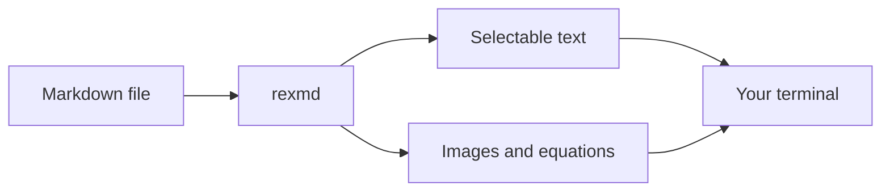

# Markdown, without leaving the terminal

A little **real text**, a little _graphics_, and a reader built for Rex.
Resize the window: paragraphs reflow, images scroll with the document, and
the text stays selectable.

> [!TIP]
> Press `t` to explore the table of contents, `?` for help, or `/` to search.
> Try searching for **clipboard** and use `n` / `N` to jump between matches.

## A picture is worth a thousand cells

Local images are drawn directly in the terminal using the Kitty graphics
protocol. No browser, no separate preview window.


SVG works too. This version uses an HTML image tag to request a smaller,
centered illustration:

<p align="center"></p>

## Code you can take with you

Syntax highlighting makes code easier to read. The `[copy]` button in the
header sends the original code to your clipboard—not its wrapped screen
representation. Tabs and line breaks survive the trip.

```go
package main

import "fmt"

func main() {
	fmt.Println("Hello from the terminal 👋")
}
```

Try copying this shell command, too:

```sh
go build -o bin/rexmd ./cmd/rexmd
./bin/rexmd docs/example.md
```

Changes are easier to scan with a highlighted diff:

```diff
- Open a browser to preview Markdown.
+ Read Markdown right where you're working.
+ Copy a snippet without its formatting.
```

### Select just the part you need

Drag across **this sentence**, then press `y` to copy the highlighted text
to your clipboard. A toast confirms the copy. Press `Esc` to clear the
selection.

`Ctrl+C` also copies a selection. On macOS, `Cmd+C` works if the terminal
forwards it to rexmd; otherwise, use `y`. Clipboard writes require OSC 52
support in your terminal.

## Equations, not escape sequences

Inline math fits into a sentence: $e^{i\pi} + 1 = 0$. Display equations get
room of their own:

$$
\int_0^\infty e^{-x^2}\,dx = \frac{\sqrt{\pi}}{2}
$$

A fenced `math` block works as well:

```math
\mathbf{A} = \begin{pmatrix} 1 & 2 \\ 3 & 4 \end{pmatrix}
\qquad
\det(\mathbf{A}) = -2
```

> [!NOTE]
> Run `rexmd setup` to enable MathJax and SVG text rendering. Without the
> helpers, math falls back to Unicode text.

## Diagrams next to the explanation

Mermaid turns a fenced block into a rendered diagram:



> [!WARNING]
> Mermaid rendering requires `rexmd setup --mermaid`. This installs
> mermaid-cli and downloads headless Chrome. Without it, the diagram's
> source remains readable.

## The everyday details

### Tables

| Content | Rendering | Try it |
| :--- | :--- | ---: |
| Prose | Reflowing terminal text | Resize |
| Code | Syntax highlighting | Copy |
| Images | Kitty graphics | Scroll |
| Equations | MathJax | Set up helpers |
| Mermaid | Rendered diagrams | Set up Mermaid |

### Lists and tasks

1. Open a document.
2. Make yourself at home.
   - Jump between headings with `]` and `[`.
   - Open the table of contents with `t`.
   - Follow a link with `tab`, then `Enter`.
3. Keep your place while you work.

- [x] Render Markdown in the terminal
- [x] Copy code without retyping it
- [x] Search and follow links
- [ ] Find an excuse to open a browser

### Quotes and emphasis

> The best preview is the one you don't have to leave your workflow to see.
>
> This is a regular block quote. It wraps while keeping its border, even
> when the terminal gets narrow.

Use **bold** for emphasis, _italics_ for a quieter aside, ~~strikethrough~~
for a revision, and `inline code` for the exact thing to type. Footnotes
keep the small print out of the way.[^details]

## Keep exploring

- [Read the README](../README.md) for installation and usage.
- [Open the original tour](../examples/tour.md) for another sample document.
- [Jump back to the code](#code-you-can-take-with-you).
- [Learn about Kitty graphics](https://sw.kovidgoyal.net/kitty/graphics-protocol/).

In Rex, focus a link and press `o` to open it in a split or `O` for a tab.
Press `e` to edit this file beside the reader; save a change to see it
reload. Use `⌫` to return after following a local document link.

---

[^details]: H1 and H2 headings can be rasterized at a larger size. Images,
    equations, and diagrams need a terminal with Kitty graphics support;
    the rest remains ordinary styled text.
