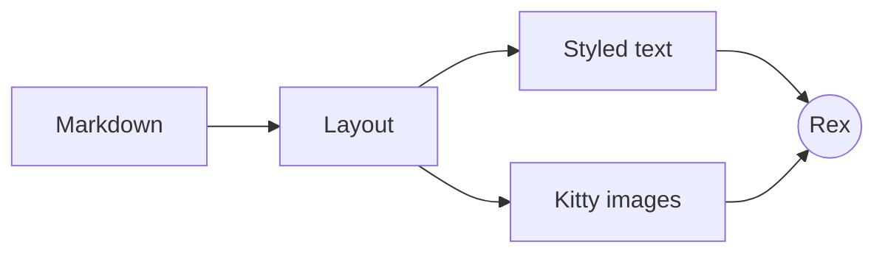

# A tour of rexmd

rexmd renders Markdown in the terminal. Text stays **real text**, so it
reflows and you can select it, and anything a terminal can't draw as text
(_images_, ~~nothing~~ diagrams, equations, big headings) is drawn with the
[Kitty graphics protocol](https://sw.kovidgoyal.net/kitty/graphics-protocol/).

> [!TIP]
> Press `t` for a table of contents, `tab` to walk through links, and `?` for
> every key.

## Images

A PNG from disk:


The same picture as an SVG, at `width="320"`:

<p align="center"></p>

## Code

```go
func main() {
	// Unicode placeholders make images scroll like text.
	fmt.Println(kitty.PlaceholderRow(id, row, cols))
}
```

```diff
- cursor-positioned placements
+ unicode placeholder placements
```

## Math

Inline math like $e^{i\pi} + 1 = 0$ sits on the line. Display math gets its
own block:

$$
\int_0^\infty e^{-x^2}\,dx = \frac{\sqrt{\pi}}{2}
$$

## Diagrams



## Tables

| Feature      | How                    | Status |
| :----------- | :--------------------- | -----: |
| Headings     | rasterized with a font |     ✅ |
| Images       | Kitty placeholders     |     ✅ |
| Live reload  | fsnotify               |     ✅ |
| Rex status   | OSC 7501               |     ✅ |

## Lists

1. Ordered lists
2. With nesting
   - bullets change by depth
     - like this
3. And tasks:
   - [x] render markdown
   - [ ] world domination

> A plain block quote, for comparison. It wraps across lines when it gets long
> enough to need it, keeping its bar on every line.

> [!WARNING]
> Mermaid needs `rexmd setup --mermaid`, which downloads a headless Chrome.

### Links

- [Back to the top](#a-tour-of-rexmd)
- [The README](../README.md), opens here; press `o` to open it in a Rex split
- Footnotes work too[^1].

---

[^1]: Like this one.
